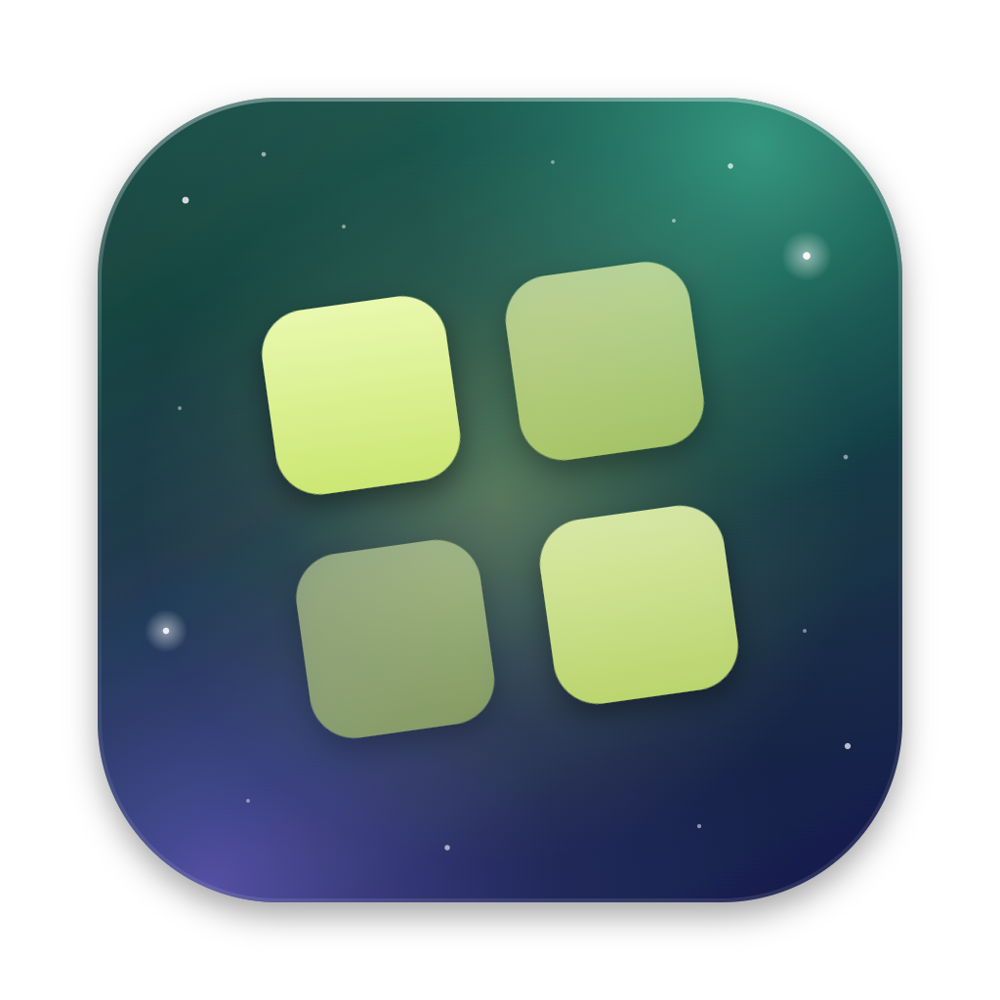
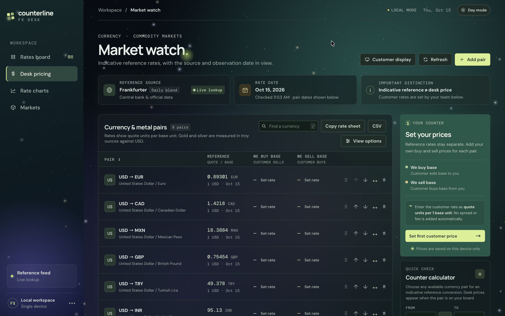
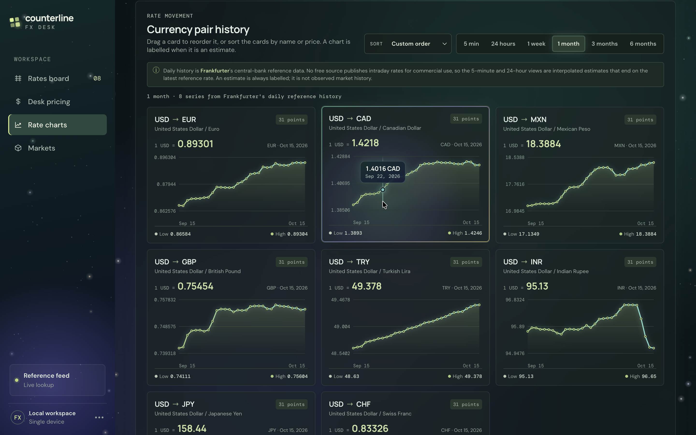
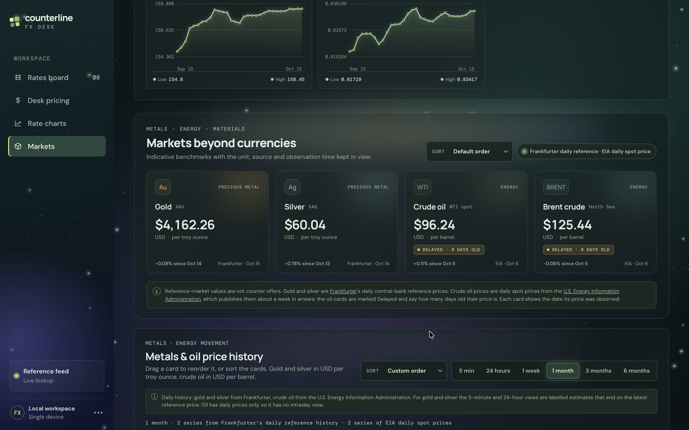
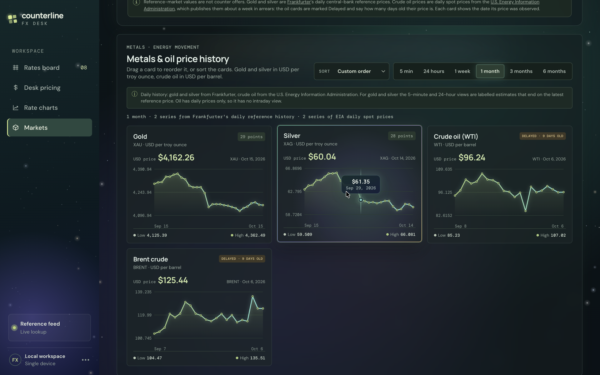
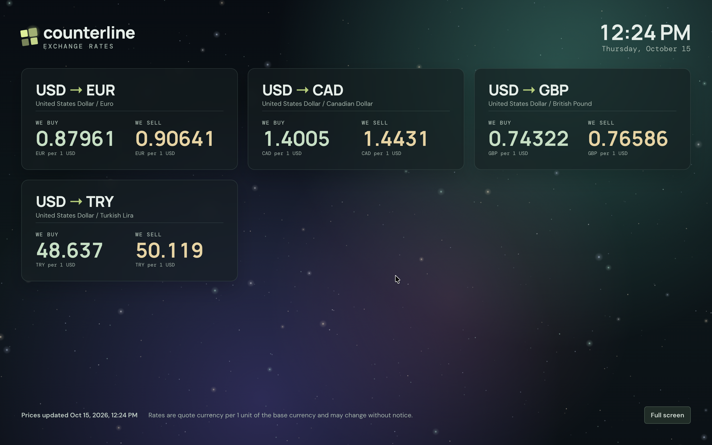

  

<h1 align="center">Counterline FX Desk</h1>

  <strong>The pricing desk for currency exchange offices.</strong> 
  Daily reference rates beside your own buy and sell prices, with margin checks, charts and a display for your customers.

  <a href="../../releases/latest"><strong>Download for Windows or macOS</strong></a>

## What is Counterline FX Desk?

Counterline FX Desk is a desktop application for money exchange offices and trading desks. It brings everything needed to quote customers into one window: the day's reference rates for the currencies you trade, gold, silver and crude oil; the buy and sell prices your desk sets; and checks that keep those prices on the right side of the market.

Your prices and settings are stored on your own computer. Nothing you enter is uploaded.

## Features

- **Rates board.** Every pair you trade, with its reference rate, the date of that rate, and your desk's buy and sell prices. Add any currency pair, reverse its direction, search, filter and arrange the board in your own order.
- **Margin guard.** Each price shows its margin against the reference rate. A price on the wrong side of the reference, or one set before the reference moved, is flagged for review. Set both prices from a chosen margin in one step.
- **Rate charts.** Price history for every pair, from one week to six months. Point at a chart to read the exact date and rate.
- **Metals and oil.** Gold, silver, WTI and Brent crude, each with its latest price and its own history chart.
- **Customer display.** A clean, full-screen board of your buy and sell prices for a screen that faces customers. It updates the moment you save a price.
- **Rate sheet.** Copy your price list as a ready-to-send table, or download it as a CSV file for your records.
- **Calculator.** Convert any amount at the reference rate or at your desk's own prices.
- **Your layout.** Light and night themes, and cards you can sort by name or price or arrange by hand.

## A closer look

### Rate charts

Every pair on your board has a history chart. Point at any day to see its rate.

### Metals and oil

Gold and silver per troy ounce, WTI and Brent crude per barrel, each with the date its price was observed.

### Metals and oil history

The same history charts for gold, silver and crude oil, from one week to six months.

### Customer display

Your buy and sell prices on a second screen, in large type, with the date and time.

## Download and install

Counterline FX Desk runs on **Windows 10 or 11** (64-bit) and **macOS 13 or later** (Apple silicon and Intel). An internet connection is needed to load rates.

1. Go to the [latest release](../../releases/latest).
2. Under **Assets**, download the installer for your computer:
   - **Windows:** `Counterline-FX-Desk-<version>-windows-setup.exe`
   - **Mac:** `Counterline-FX-Desk-<version>-mac.dmg`
3. Install the app:
   - **Windows:** open the downloaded `.exe` file. Counterline FX Desk installs, adds itself to the Start menu and the desktop, and opens.
   - **Mac:** open the downloaded `.dmg` file and drag **Counterline FX Desk** onto the **Applications** folder, then open it from Applications or Launchpad.

**If your computer asks for confirmation the first time you open the app:**

- **Windows:** on the "Windows protected your PC" screen, select **More info**, then **Run anyway**.
- **Mac:** open **System Settings › Privacy & Security**, scroll to the message about Counterline FX Desk and click **Open Anyway**.

To update, download the latest installer and install it over your current version. Your prices and settings are kept.

## About the data

Rates shown in Counterline FX Desk are reference rates for information. They are not quotes or offers to trade.

Crude oil prices (WTI and Brent) come from the U.S. Energy Information Administration (EIA), which publishes them about once a week, several days after the trading day. An oil price can therefore be a week or more old. The app marks every oil price as **Delayed** and shows how many days old it is. Do not treat these prices as live market prices.

Currency, gold and silver rates are daily reference rates from central banks and other official sources.

---

  © 2026 Shahin Hassanyan. All rights reserved. 
  Counterline FX Desk is proprietary software. The source code is published for viewing only; see <a href="LICENSE">LICENSE</a>.

